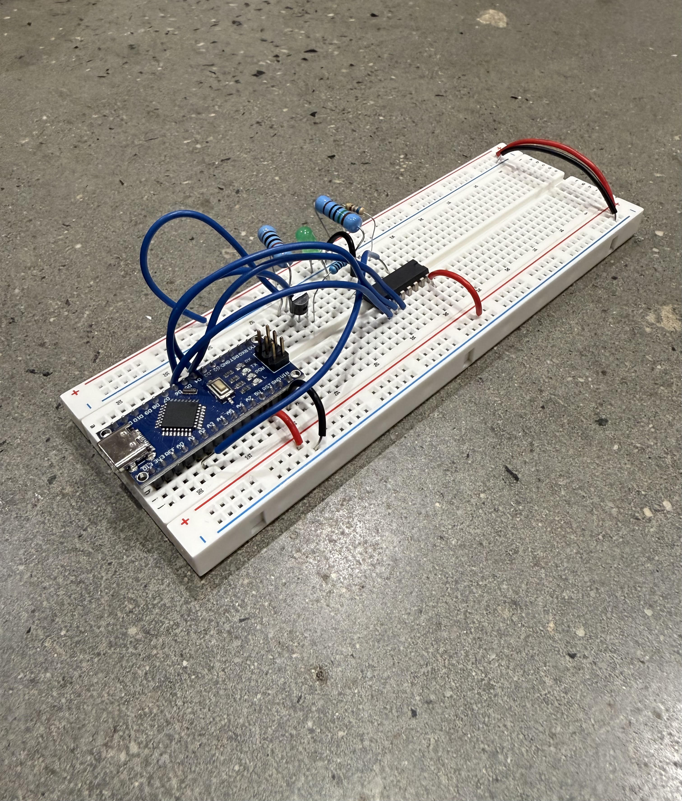

# RFR Temperature Monitoring System

Arduino-based temperature monitoring system that uses **Analog Multiplexing**, **Voltage Dividers**, and **MOSFET Switching** to monitor multiple temperature sensors and activate an LED warning system based on the highest measured temperature.

---

# Project Overview

This project was completed as part of a four-person new member team project for the Rutgers Formula Racing Electronics Subteam.

My main contribution was leading the hardware development, selecting electrical components, designing the circuit, and constructing the physical prototype while also contributing to the embedded C++ code.

The circuit was designed to support 16 temperature sensors, with an 8-channel breadboard prototype constructed to simplify physical implementation and testing.

The system is designed to:

- Monitor multiple temperature sensors using a single analog input
- Convert analog voltage readings into temperature values
- Determine the highest measured temperature
- Activate a flashing LED when temperatures exceed 60°C
- Activate a continuous LED when temperatures exceed 80°C
- Communicate individual temperature readings through I2C

---

# Circuit Design & Component Selection

My design applies several electrical engineering concepts to simplify the circuit and allow for additional temperature sensors.

### Analog Multiplexing

The CD74HC4067 analog multiplexer allows 16 temperature sensors to share a single analog input on the Arduino Nano.

I chose to use a multiplexer to reduce the number of Arduino pins required and allow for additional temperature sensors without requiring another microcontroller.

### Temperature Sensing & Voltage Dividers

Each temperature sensor is connected to a 10 kΩ pull-up resistor to create a voltage divider. As the temperature increases, the resistance of the sensor decreases, resulting in a lower voltage being measured by the Arduino.

I chose 10 kΩ resistors to limit current through the sensors while maintaining measurable changes in voltage.

### MOSFET Switching

The 2N7000 N-channel MOSFET acts as a switch that allows the Arduino to control the warning LED.

The resistor values were selected for the following purposes:

- **220 Ω Gate Resistor** – Limits current spikes when switching the MOSFET.
- **10 kΩ Pull-Down Resistor** – Keeps the MOSFET off when no control signal is applied.
- **330 Ω LED Resistor** – Limits current through the LED to approximately 9 mA.

### Voltage Regulation

The L7805CV voltage regulator converts the 12V input into a 5V supply for the circuit.

I chose a linear voltage regulator to simplify the circuit and reduce the number of components required.

---

# Visualizations

## 16-Channel Circuit Schematic

The expanded circuit was designed in Altium Designer to represent the full 16-channel implementation of the temperature monitoring system.

---

## 8-Channel Breadboard Prototype

The physical prototype was constructed using eight temperature inputs instead of sixteen to reduce the complexity of the breadboard circuit while demonstrating the same functionality. The circuit is designed to connect to external temperature sensors in each of the 8 inputs on the multiplexer (not shown in this image).

---

# Embedded Firmware

The embedded C++ code uses three digital selection pins to cycle through the eight temperature inputs.

Ten analog readings are taken and averaged for each sensor to reduce fluctuations in the measured voltage. A short delay between channel selections allows the voltage to settle before measurements are taken.

The averaged readings are converted into estimated temperatures using a linear calibration equation. The highest measured temperature determines the output of the warning LED.

| Maximum Temperature | LED Output |
| --- | --- |
| 60°C or below | Off |
| Above 60°C through 80°C | Flashing |
| Above 80°C | Continuous |

I2C communication allows individual temperature readings to be requested by an external device.

[View Arduino Source Code](RFR_code_final.ino)

---

# Technologies & Components

- Arduino Nano
- CD74HC4067 Analog Multiplexer
- 2N7000 N-Channel MOSFET
- L7805CV Voltage Regulator
- Temperature Sensors
- Altium Designer
- Embedded C++
- I2C Communication
